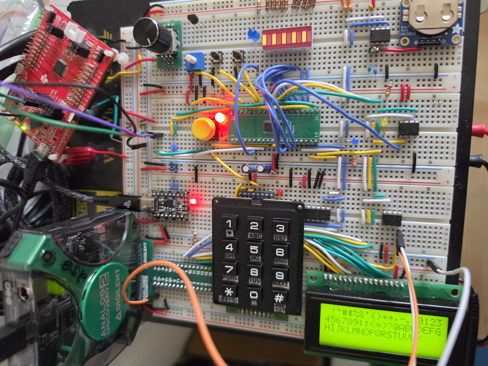
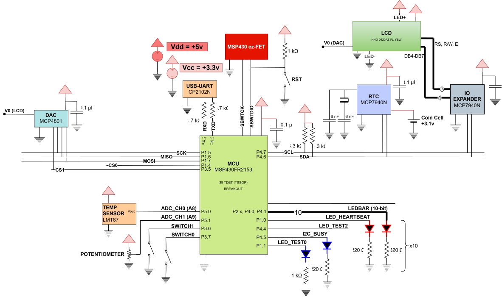
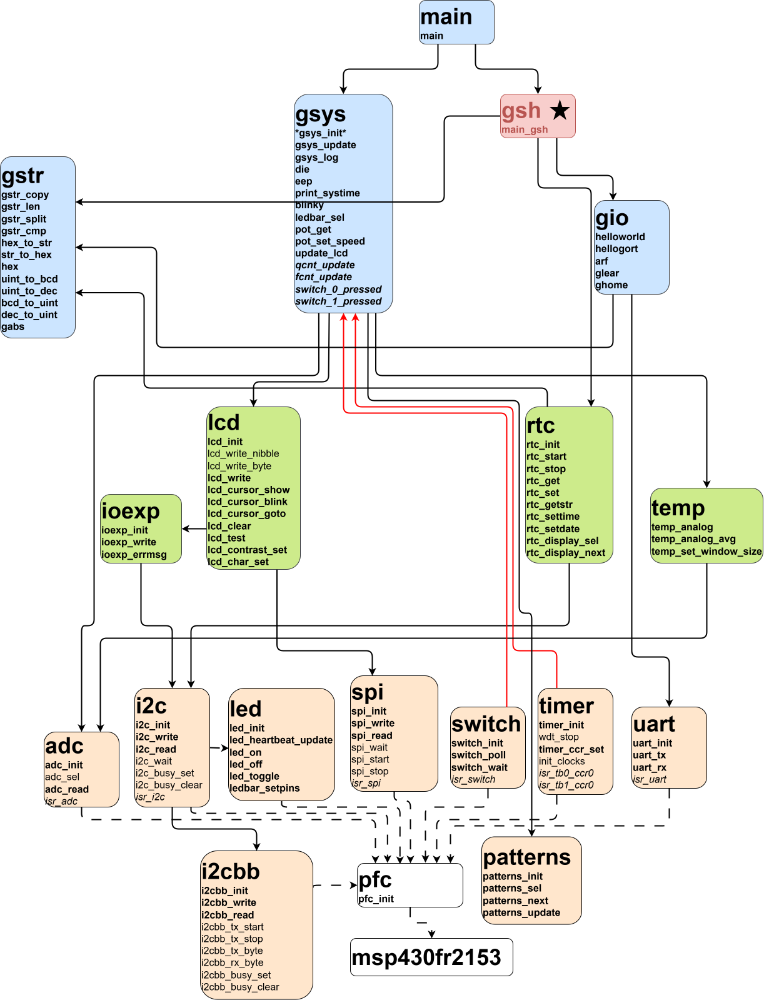

# Gort OS - an Embedded Operating System
#### Author: [Ryan Dupuis](https://github.com/rdupu13)

## Platforms:
* **TI MSP430FR2153 microcontroller unit**

---
```
MSP430FR2153 needs an operating system, and gort is up to the task!

no one could ever fathom that gort would ever have an os

behold, GORTOS!
```
---

## [Features](docs/planning/gortos.md)
Gort OS is fully functional with driver support for the following peripherals:

* 4 Timer Modules (TIMER)
* Universal Asynchronous Receiver-Transmitter (UART)
* Inter-Integrated Circuit (I2C, I2CBB)
* Serial Peripheral Protocol (SPI)
* Analog-to-Digital Converter (ADC)
* 26 General-Purpose I/O pins (SWITCH, LED)
* General-Purpose Pattern Generator (PATTERNS)

Gort OS supports a variety of breadboard modules, suitable for nearly any embedded project:

* Reset switch
* 2 General-Purpose Switches
* Heartbeat and Mode LED
* 10-LED bar
* 1 Potentiometer
* CP2102N USB-to-UART
* Battery-Powered MCP7940N Real-Time Clock Module (RTC)
* LMT87 Temperature Analog Sensor (TEMP)
* MCP23008 I/O Expander (IOEXP)
* NHD-0420AZ-FL-YBW Liquid Crystal Display Module (LCD)
* MCP4801 Digital-to-Analog Converter (DAC)
* more soon...


## Development

Follow instructions [[here](https://github.com/rdupu13/msp430-dev/blob/main/msp430_dev_setup.md)] for how to setup your own MSP430 development environment on Linux or WSL. No Code Composer Studio required!

## EELE 465

This project was created in part to fulfill the requirements of the MSU course [EELE 465 - Microcontroller Applications](https://catalog.montana.edu/coursedescriptions/eele/). Below are reports detailing the development and testing of several components of the Gort System:

* Lab 0: [Heartbeat LED](mcu/test/main.c) (circa. 2024)
* Lab 1: GitHub and Markdown (circa. 2025)
* Lab 2: [I2C Bit-Banging](docs/labs/lab2_i2c_bb.md) (8/24/2026)
* Lab 3: [RTC and LED Patterns](docs/labs/lab3_rtc_patterns.md) (~7/12/2026 - 7/26/2026)
* Lab 4: [ADC and SPI](docs/labs/lab4_adc_spi.md) (9/14/2026, 11/16/2026)
* Lab 5: [LCD and DAC](docs/labs/lab5_lcd_dac.md) (11/16/2026)
* Lab 6: [Dial, Menu, Gort System, and Gort Shell](docs/labs/lab6_dial_menu.md) (11/30/2026)
* Final Project: [Serial RAM and File System Interface](docs/planning/final_project_proposal.md) (p. 11/9/2026, 12/14/2026)

[Course BOM](docs/planning/eele465_bom.md)

## Breadboard


## Circuit Diagram


## Software Architecture


---
P.S. gorb is my bb <3