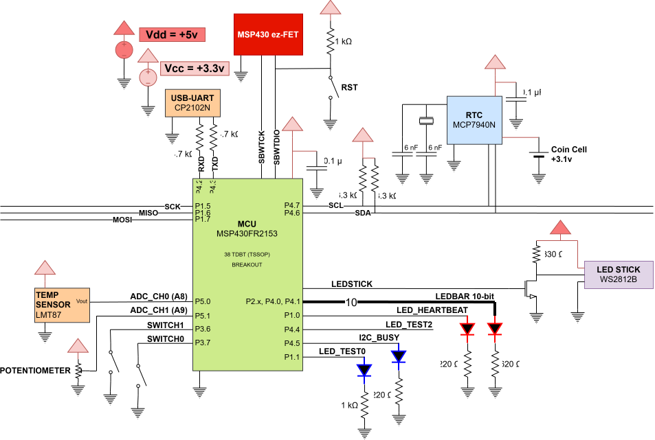
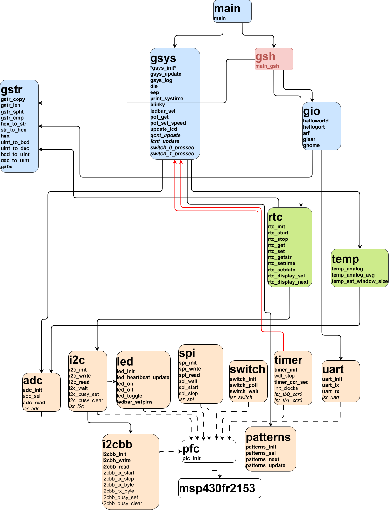
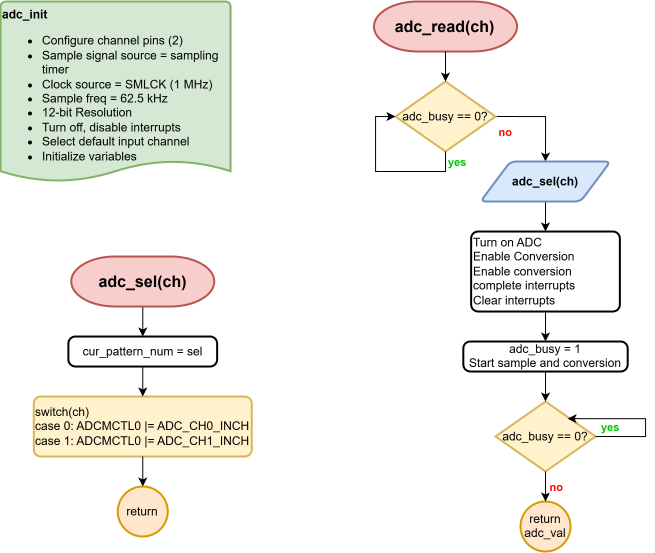
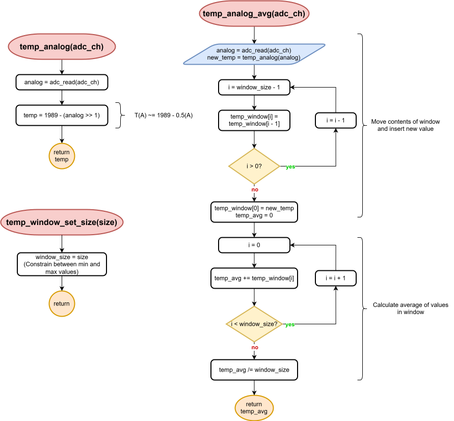
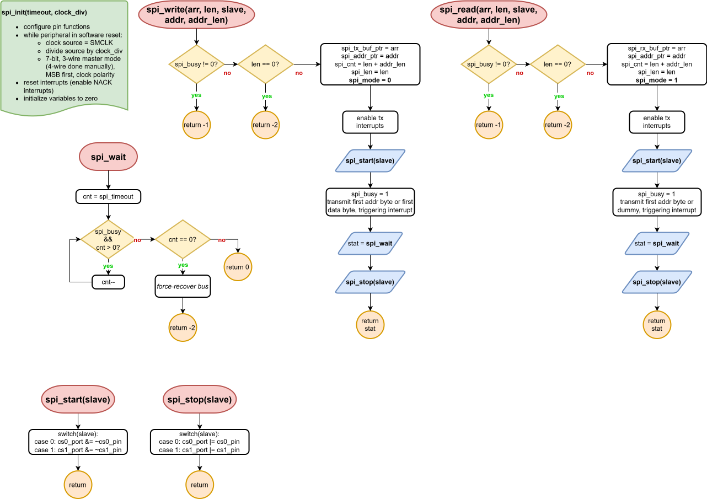
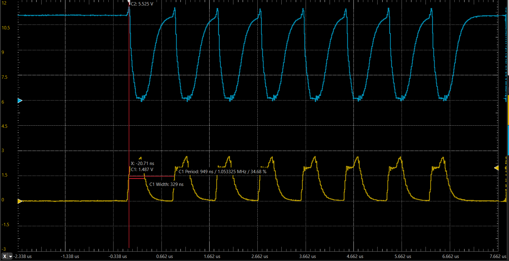

# Lab 4: ADC and SPI

#### Ryan Dupuis
#### EELE 465 | 9/14/2026 (*Revised 11/16/2026*)

## Introduction

In this lab, I added to the Gort System by incorporating an analog temperature sensor, a potentiometer, and adding dedicated ADC and SPI drivers. The temperature sensor performs real-time calculations to convert an ADC value to a temperature. I also attempted to bit-bang an LED Stick with a ridiculous high-speed protocol. Though I gave it a good try, since it was so unfriendly to MSP430s, I gave up on it. Many requirements in this lab were satisfied by the Gort Shell and Gort System, which will be described in more detail in [Lab 6](lab6_dial_menu.md).

All source files are located here: [mcu/src/](../../mcu/src/).

## Circuit Diagram
### Requirements met: 



## Software Architecure



## Analog-to-Digital Conversion
### Requirements met: 1, 6

The driver for Gort's [ADC](../../mcu/src/drivers/adc.c) is a standard abstraction of the MSP430 12-bit ADC peripheral. An `adc_read` function takes a channel number and reads the analog voltage at the pin associated with that channel (defined in [`pfc.h`](../../mcu/include/hw/pfc.h)). This analog voltage is converted in hardware to a 12-bit unsigned integer (0 - 4095), which the function returns. `adc_read` automatically selects the channel with `adc_sel` before sampling and converting. This driver uses interrupts! 

```c
void adc_init(void);
unsigned int adc_read(unsigned char ch);
```



## Temperature Sensor Driver
### Requirements met: 2, 2.1, 3, 3.1

Building on top of the ADC driver, I developed another driver for Gort's first [temperature sensor](../../mcu/src/devices/temp.c), specifically the **analog LMT87**. This device is super simple, with just one analog output voltage that corresponds to some temperature between -50 and 150 C. The datasheet provides a table and equation for which temperatures correspond to which voltages. I used this info, combined with ADC values obtained from the potentiometer, to ultimately discover the relationship between the ADC value N (`adc_val`) and temperature T.

The equation provided by the LMT87 is complicated but equivalent to about:

$$T(v) = 1724.8\sqrt{1-0.0000776v} - 1538.36$$

Where T(v) is temperature v is the output voltage in mV and ranges from 0 to 3300 in Gort OS. Doing a linear approximation around v = 2.366 V, which is when the sensor should be reading 20 C, results in this equation:

$$T_L(v) = 195.33 - 0.0745v$$

Now, if we know how v relates to N, we can figure out T_L(N). Using an AD2 scope and a potentiometer, I arrived at the following equation for an ADC value:

$$N(v) = 1.534v - 50$$

Where v is any channel voltage. If we solve for v in terms of N, we get:

$$v(N) = 0.652N + 32.595$$

This can be substituted into the temperature equation, assuming the channel voltage is the sensor's output, to get:

$$T_L(N) = 192.9 - 0.0483N$$

For temperatures between +40 C and -11 C, this function is very accurate. Since we want 1 decimal point of precision, we have to multiply the above equation by 10:

$$T_L(N) = 1929 - 0.483N$$

Then, *it would be really nice* if the 0.483 fraction could be simplified to 0.5, which is easily implemented with a single bit shift. Doing this misaligns the equation with the original, but shifting it upward by 60 seemed to fix it. Finally, the implemented equation is:

$$T_L(N) = 1989 - 0.5N$$

But it doesn't even work that well! Fine, whatever! >:/

```c
int temp_analog(unsigned char adc_ch);
int temp_analog_avg(unsigned char adc_ch);
void temp_window_set_size(unsigned int size);
```



Once the temperature conversion was reasonable, I added a moving average window. This adds each reading to a queue, of which the average is calculated and returned in `temp_analog_avg`. The oldest values are discarded.


## SPI Driver
### Prerequisite for future labs

The [SPI Driver](../../mcu/src/drivers/spi.c) communicates with the eUSCI A0 peripheral to send and receive SPI bytes. This was intended to be a prerequisite for the LED Stick, but that did not go as planned. SPI will be used for **2 peripherals** in Lab 5 for the DAC and in the final project. Gort OS uses a 4-wire SPI Master configuration (SCLK, MISO, MOSI, CSx), with a unique 'x' for each SPI slave address. It uses SMCLK (1MHz), CKPH = 0, CKPL = 1, and MSB first.

`spi_init` takes a timeout value and a clock division parameter. The timeout value is (roughly) the number of clock cycles before a transaction is considered *overdue*, and the peripheral is jammed. I have this mechanism on the peripheral version of I2C, so I added it to SPI as well. `spi_write` and `spi_read` take the same arguments: a pointer to the array of data to write/read, the length of that array, the SPI slave address, and then a new feature: an instruction/address header. This is send/received as the data array is, but it always comes *first* and is always *sent*, in both `spi_write` and `spi_read`.

```c
void spi_init(
    unsigned int timeout,
    unsigned int clock_div
);
int spi_write(
    unsigned char *arr,
    unsigned int len,
    unsigned char slave,
    unsigned char *addr,
    unsigned int addr_len
);
int spi_read(
    unsigned char *arr,
    unsigned int len,
    unsigned char slave,
    unsigned char *addr,
    unsigned int addr_len
);
```



## LED Stick Driver (Attempted)

I attempted to interface with the WS2812B RGB LED stick, which is a very strange "serially"-addressable module. After encountering great difficulty when trying to abuse the SPI MOSI line, I switched to bit-banging the data directly from `gsys`, so it doesn't technically have its own driver file. Unfortunately, the timing requirements are incredibly tight and unlike any other device I've seen. Logic 1's are counted as a long-pulse (66% duty) and logic 0's are counted as a short-pulse (33% duty) with a lightning-fast ~1 microsecond period. To further complicate matters, the LED stick wants a 5v input, not 3.3v. This required a simple NMOS inverter that steps up the MCU output, as seen in the circuit diagram at the start.

```c
unsigned char b = 0x4D;
unsigned char s = (b & 0x80);
unsigned int i;
for (i = 0; i < 8; i++)
{
    LEDSTICK_PORT &= ~LEDSTICK_PIN;
    if (s) {
        __asm__ __volatile__("nop");
    }
    LEDSTICK_PORT |= LEDSTICK_PIN;
    s = ((b << 1) & 0x80);
}
```


The oscilloscope screenshot represents the best results I was able to obtain. The yellow channel (bottom) shows the MCU output voltage and the top channel (blue) shows the voltage at the drain terminal of the NMOS. The period is about 950 ns with a consistent ~33% duty cycle. As evident by the waveform, there are capacitive effects with the NMOS that are causing delays when switching at such a high speed.

I've had a difficult time fitting in the necessary test code without causing too much delay to where the duty cycle is messed up or the period is too long. I hate this LED stick and its manufacturers are evil.

## Gort System
### Requirements met: 1.1, 7, 7.2, 7.3, 7.4
See [Lab 6](lab6_dial_menu.md).

## Gort Shell
### Requirements met: 4, 5, 5.1, 5.2, 11, 12, 13, 14
See [Lab 6](lab6_dial_menu.md).

## Conclusion
### Unmet requirements: 6.1, 8, 9, 9.1, 10

