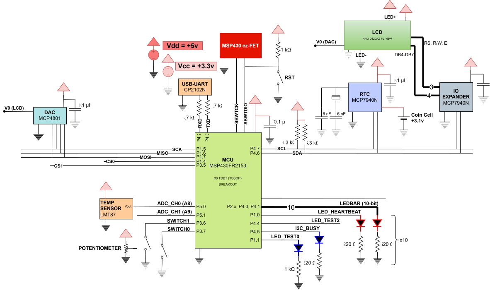
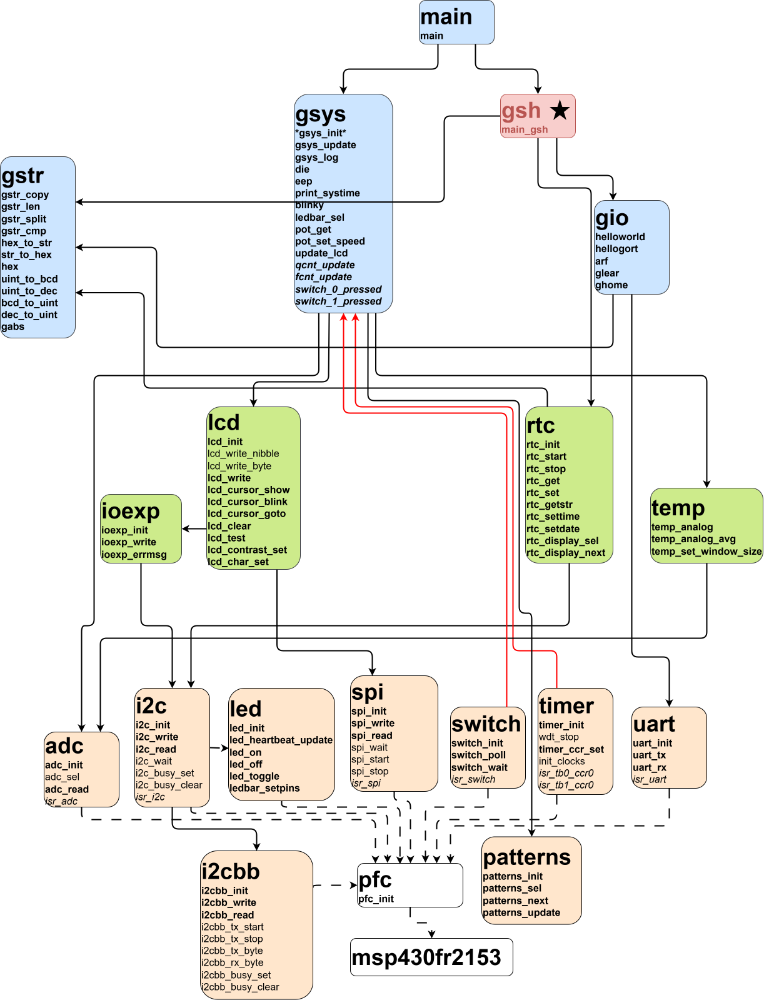
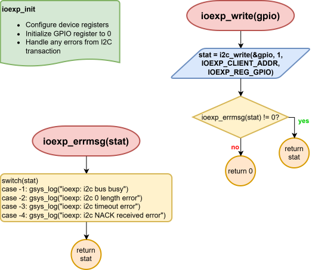
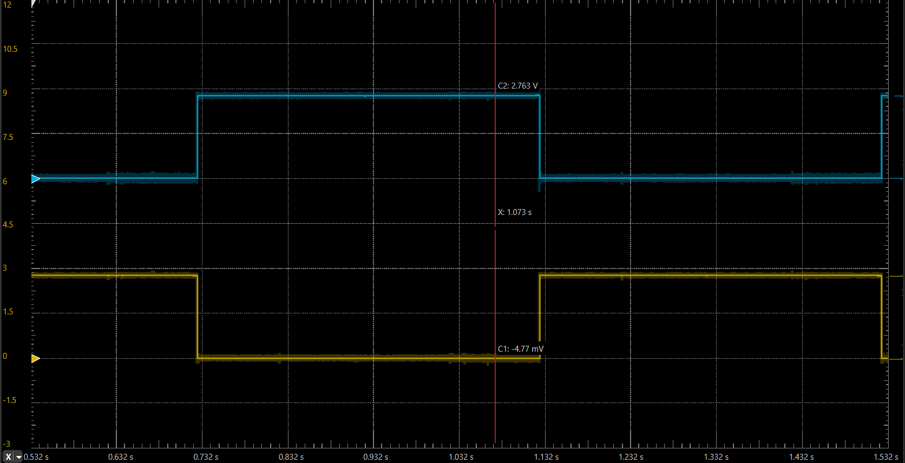
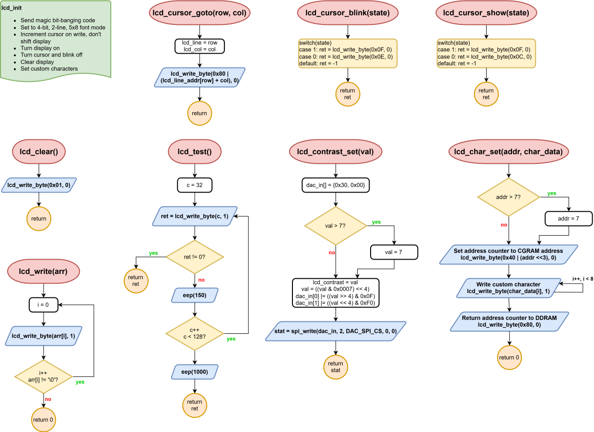

# Lab 5: LCD and DAC

#### Ryan Dupuis
#### EELE 465 | 11/16/2026

## Introduction

In this lab, I printed all the things on a newly-added LCD display with a digital-to-analog converter (DAC) for contrast control. In addition, I finally updated the Gort Shell to accept user input to set system variables such as time, date, temperature sensor window size, and LCD contrast.

All source files are located here: [mcu/src/](../../mcu/src/).

## Circuit Diagram
### Requirements met: 9



## Software Architecure



## I/O Expander Driver
### Prerequisite for LCD Driver

Adding an LCD to Gort OS without more GPIO pins would leave no room to complete the course with the required components wired to the MCU. An I/O expander is a component that converts serial data to parallel port data, effectively increasing the number of external pins the MCU can read/write. An [I/O Expander Driver](../../mcu/src/devices/ioexp.c) was developed to interface through I2C with the **MCP23008** chip, and therefore the LCD, which is connected on the parallel side of the expander.

After wiring the device up, I consulted the datasheet to find out the I2C slave register layout and how to control it. Since I'm only using the expander to add more outputs, I'm not using the input or interrupt features that are available. Most registers are set to 0 or default values except for  This is the first time I tried using a dedicated error message function, and I believe it works well, though none of the errors have gone off so far anyway!

```c
int ioexp_init(void);
int ioexp_write(unsigned char gpio);
```


To test the device, I modified `gsys_update` to send alternating bytes 0x55 and 0xAA. This helped me confirm with an oscilloscope that data was being written to the expander. I connected probe 1 to an even bit and probe 2 to an odd bit. It worked first try, as seen in the screenshot below where the signals alternate.



## LCD Driver
### Requirements met: 1-8

For Gort's [LCD Driver](../../mcu/src/devices/lcd.c), we again harken back to the days of EELE 467 - particularly my final project. This LCD is extremely similar to the one I used in that course, with the only difference being that it's powered with +3.3v instead of +5v. 


```c
int lcd_init(void);
int lcd_write(unsigned char *arr);
int lcd_cursor_show(unsigned char state);
int lcd_cursor_blink(unsigned char state);
int lcd_cursor_goto(
    unsigned char row,
    unsigned char col
);
int lcd_clear(void);
int lcd_test(void);
int lcd_contrast_set(unsigned char val);
int lcd_char_set(
    unsigned char addr,
    unsigned char *char_data
);
```



## Gort System
### Requirements met: 12-16

See [Lab 6](lab6_dial_menu.md).


## Gort Shell
### Requirements met: 10, 11

See [Lab 6](lab6_dial_menu.md).


## Conclusion
### Unmet requirements: None!

