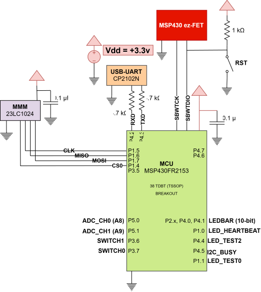
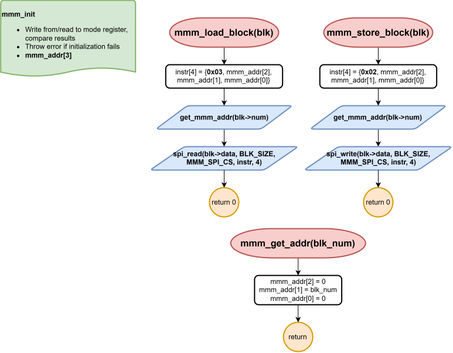
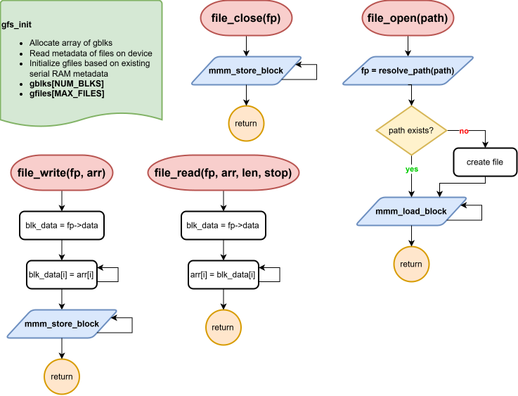

# Final Project Proposal

#### Ryan Dupuis
#### EELE 465 | 11/10/2026

## Embedded System Description

My final project for Gort OS will consist of a mock Linux file system interface. While the LCD menu + keypad UI would remain the default, by holding switch 0 during initialization, a user can access the terminal. I want to be able to read from and write to real files stored on an external device using this terminal interface. It will use SPI, a custom device driver, 2 additional data structure designs, basic algorithms for file management, and an existing shell interface built on top of UART.

### Prescaler
- [x] 100%
- [ ] 95% 
- [ ] 90% 
- [ ] 85% 
- [ ] 80% 
- [ ] 75% 

## Hardware Setup

A **23LC1024 Serial SRAM** is to be connected to the existing SPI lines and the +3.3v power rails. The active-low chip select line will be connected to P1.4 of the MCU and the HOLD input will be tied high for continuous use. I will use the device in normal SPI mode, not dual- or quad-SPI mode. The device holds a whopping **128 KB** of data accessible by individual bytes or in 32-byte pages, controlled by the 2 most significant bits of its mode register. I'll provide a 0.1 uF bypass capacitor for current surges.

## Software Overview

### Mini Memory Manager

Built atop the SPI driver interface, a device driver called the [Mini Memory Manager (MMM)](../../mcu/src/devices/mmm.c) is to control the 23LC1024 and expose its basic functionality. Too keep it as simple as possible, it only has 2 functions (besides `mmm_init`): `mmm_load_block` and `mmm_store_block`. According to some fixed system `BLK_SIZE` (default 256 bytes), the MMM will divide the memory into chunks for simple loading and storing. Initialization will simply read from the mode register, set its upper two bits to '10', and write it back.

Both loading and storing begin on SPI with a 1-byte instruction indicating the transaction type (x03 for Read, x02 for write). Then, a 3-byte (17-bit) address is sent to . The driver will do the work of determining which address to begin at given the block object pointer (`*gblk_t blk`) and the helper function `get_mmm_addr`. For simplicity, only the lower 2 bytes of the address will be used in this project, so the first address byte is always x00. The bytes after the address are the data to be read from/written to that location. The caller must allocate the necessary cache space on MCU RAM for each block.

### Gort File System

An additional kernel layer named the [Gort File System (GFS)](../../mcu/src/kernel/gfs.c) will keep track of files stored on the MMM. Via the Gort Shell, it will allow users to create (`file_open`) and edit (`file_write`, `file_read`) "large" files. GFS will keep track of a local cache of Gort Blocks (`gblks`) in MCU RAM. Since space is limited, the default number of Gort Blocks is 2. As the caller of the MMM's load and store functions, it must provide a pointer to each  `gblk_t` that a file is using. Each `gfile_t` will contain the following metadata:

* Mode: 000 rwx tt
    - r: read permission
    - w: write permission
    - x: execute permission (optional)
    - tt: '00' = normal text file, '01' = directory (optional), '10' = device file!
* Size: # of `gblk_t`s
* Name: 16 B max, including extension (e.g. "file.txt")
* Data: Pointer to starting block

The rest is data that does *not* get stored externally. These are virtual parameters known only by the MCU:

* Loaded: '0' = not loaded & only exists on external device, '1' = loaded & available for read/write

### Gort Shell

The [Gort Shell](../../mcu/src/apps/gsh.c) counts as an additional component to the final project, though it was originally created to satisfy requirements from previous labs, such as modifying the system time and the temperature's moving average window size.

<!--  -->

### Gort String Library

The [Gort String](../../mcu/src/kernel/gstr.c) Library provides various string manipulation and conversion functions.

<!--  -->

## Testing procedure

While building the architecture, I'll begin at the lowest level with wiring and basic read/write testing of the SRAM. After connecting it to power and SPI, I will send the Read Mode Register (x05) instruction to test if the chip responds. Then, I will try writing to this register and reading the value back to make sure it retains data. Once I can do the same to data at any address on the device is when I can verify the MMM driver works. Building a mode register read/write into the initialization error structure of Gort OS will aid in future debugging.

Before the GFS can be built, `gblk_t` allocation must be tested at `BLK_ALLOC_NUM` = 2 blocks and `BLK_SIZE` = 256 bytes. Block allocation limits the maximum stack size, so a reasonable estimation of maximum stack size may have to be calculated. I will then verify that the MMM driver can read from/write too these blocks. I will begin development on GFS with initializing the file system and opening/closing a file. After, I'll try writing from/reading to it. I'll top off testing with a full integration with GSH. Hopefully by then, it will use the correct version of a few of the [GSTR functions](../../mcu/src/kernel/gstr.c).